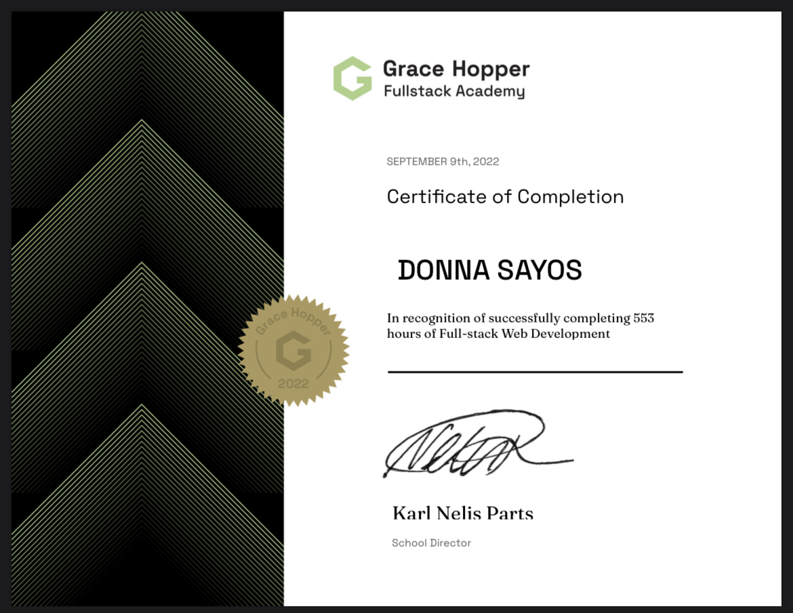

<div align="center">

```text
┌─────────────────────────────────────────────────────────────┐
│  [●][●][●]  donna@dev-machine:~                             │
├─────────────────────────────────────────────────────────────┤
│                                                             │
│   > System.init()                                           │
│   > Loading Profile...                                      │
│                                                             │
│   ██████╗  ██████╗ ███╗   ██╗███╗   ██╗██████╗              │
│   ██╔══██╗██╔═══██╗████╗  ██║████╗  ██║██╔══██╗             │
│   ██║  ██║██║   ██║██╔██╗ ██║██╔██╗ ██║███████║             │
│   ██║  ██║██║   ██║██║╚██╗██║██║╚██╗██║██╔══██║             │
│   ██████╔╝╚██████╔╝██║ ╚████║██║ ╚████║██║  ██║             │
│   ╚═════╝  ╚═════╝ ╚═╝  ╚═══╝╚═╝  ╚═══╝╚═╝  ╚═╝             │
│                                                             │
│   Software Engineer • Computer Science & Math @ Hunter      │
│                                                             │
└─────────────────────────────────────────────────────────────┘
```


# Hi, I'm Donna Sayos 👋

<a href="https://www.linkedin.com/in/dsayos/" target="_blank" rel="noopener noreferrer"></a>&nbsp;&nbsp;&nbsp;&nbsp;<a href="https://donna-sayos.netlify.app" target="_blank" rel="noopener noreferrer"></a>

</div>

---

## **👩‍💻 About Me**

- **Bootcamp Alum:** Graduated from the **Grace Hopper Program at Fullstack Academy** (Software Engineering Certification).
- **Current Education:** Pursuing a **Bachelor of Arts in Computer Science** with a **Math Minor** at Hunter College.
- 🎓 **Expected Graduation:** `May 2027`

---

## **🛠️ Technical Stack**

### **Languages & Frameworks**
<p>
  
  
  
  
  
  
  
  
  
  
  
</p>

### **Databases & APIs**
<p>
  
  
</p>

### **Tools & Technologies**
<p>
  
  
  
  
  
  
  
  
  
  
  
</p>

---

## **📜 Certifications**

### **Grace Hopper Program at Fullstack Academy**
*Certificate of Completion — Full-Stack Web Development (553 Hours)*

<br>

<div align="center">
  
</div>

---

<div align="center">
  <sub>Feel free to explore my pinned repositories below!</sub>
</div>
